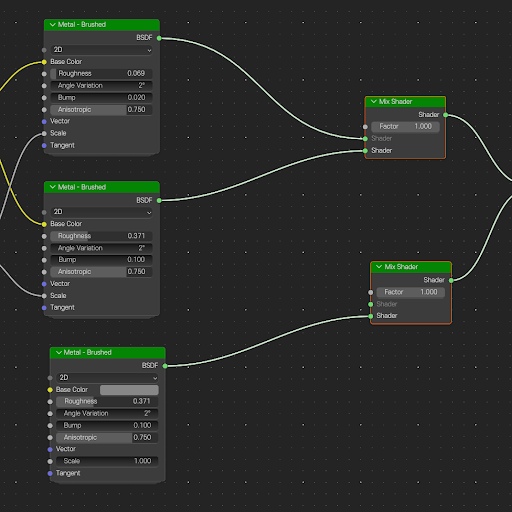
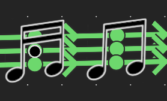
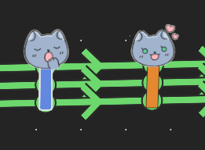
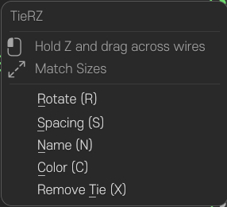
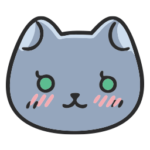

# TieRZ
TieRZ는 블렌더(Blender)에서 복잡하게 얽힌 노드 링크들을 드래그 가능한 케이블 타이(리라우트 번들)로 묶어 정리해주는 애드온입니다. 순정 블렌더 환경에서 문제없이 작동하며 네이티브 노드 연결 구조를 100% 온전하게 유지합니다.

---

## 📸 Before & After

| 정리 전 (얽힌 와이어) | 정리 후 (TieRZ 케이블 타이) |
| :---: | :---: |
|  |  |

---

## 🎨 타이 디자인 & 유니크 스타일 (Tie Styles)
TieRZ는 N 패널에서 다양한 타이 디자인을 선택하고 변경할 수 있습니다:
- **Classic Cable Tie**: 깔끔하고 직관적인 기본 라벨 태그 스타일
- **MACHOCAT**: 귀여운 고양이 얼굴 형태의 타이 디자인
- **MUSIC NOTE**: 리드미컬한 음표 형태의 감각적인 타이 디자인

| MACHOCAT | MUSIC NOTE |
| :---: | :---: |
|  |  |

---

## 주요 기능 (Features)
- 와이어 위를 가로질러 그으면 이동 가능한 케이블 타이로 자동 결속됩니다.
- 타이를 우클릭하여 회전(Rotate), 간격(Spacing), 이름(Name), 색상(Color), 타이 해제(Remove)를 즉석에서 제어합니다.
- N 패널을 통해 타이 디자인 및 테마 스타일(`MACHOCAT`, `MUSIC NOTE` 등)을 자유롭게 변경할 수 있습니다.
- 순정 블렌더 기본 조작감과 완벽히 일치하여 다루기 매우 직관적입니다.
- 클린 언인스톨(Clean Uninstall): 제어 데이터를 완전 제거하여 협업자 전달 시 잔여물이 남지 않습니다.
- 다국어 인터페이스: 한국어, 영어, 중국어(간체), 일본어 지원 (`i18n/*.json`으로 추가 언어 확장 가능).

---

## 설치 방법 (Installation)
1. [GitHub Releases](https://github.com/narznarz/TieRZ/releases)에서 최신 배포 `.zip` 파일을 다운로드합니다. *(압축을 풀지 마세요)*
2. Blender 실행 후 `Edit > Preferences > Add-ons` (4.2+ / 5.x는 `Get Extensions`) 이동 후 우측 상단 `Install...` 클릭, 다운로드한 `.zip` 선택.
3. 목록에서 **TieRZ** 애드온 체크 활성화.
4. 노드 에디터 사이드바(N 패널)에 `TieRZ` 탭이 생성됩니다.

---

## 사용법 (Usage)
- **타이 생성 (Create a tie)**: 제스처 키(기본 `Z`)를 누른 채 와이어를 가로질러 드래그합니다.
- **타이 이동 (Move a tie)**: 타이를 클릭한 채 드래그하면 위치를 옮길 수 있습니다. 드래그 중 `Shift`를 누르면 자유 회전합니다.
- **선 긋기로 삭제 (Remove ties with a stroke)**: 제스처 키(기본 `Z`)를 누른 채 타이 위로 선을 그으면, 겹친 타이가 **빨간색**으로 표시되고 놓으면 삭제됩니다(여러 개 동시 가능). 리라우트는 유지됩니다.
- **우클릭 메뉴 (Right-click menu)**: 선택된 타이 위에서 우클릭 → Rotate (R) / Spacing (S) / Name (N) / Color (C) / Remove (X).
- **N 패널 (N panel)**: 선택된 타이의 이름, 색상, 간격, 스타일(`MACHOCAT`, `MUSIC NOTE` 등) 및 외형 편집.
- **크기 맞춤 (Match sizes)**: `Alt+S`로 선택된 여러 타이의 칼라 크기/너비 균일 통일.
- **함께 이동 (Move selected)**: `G` 키로 선택된 노드 및 타이를 자연스럽게 동기화 이동.
- **제거 (Remove)**: `X` 또는 `Del` (선택된 타이만 해제, 리라우트는 유지).

  

### 단축키 (Keys)
| 키 | 기능 동작 |
|---|---|
| `Z` (누른 채) + 드래그 | 와이어를 가로질러 타이 결속, 또는 타이 위로 그어 삭제 (빨간색 표시) |
| 클릭 + 드래그 | 타이 이동. 드래그 중 `Shift`를 누르면 회전 |
| `R` | 선택된 타이 자유 회전 (부드러운 마우스 회전) |
| `S` | 내부 번들 와이어 간격 조절 |
| `N` | 선택된 타이 이름 라벨 지정 |
| `C` | 식별 컬러 태그 순환 변경 |
| `X` / `Del` | 선택된 타이 삭제 (리라우트 유지) |
| `Alt+S` | 선택된 타이 크기 일치 |
| `G` | 연결된 노드 및 타이 함께 이동 |

---

## 실무 주의사항 (Warnings)
- **언인스톨 클린 정리 (Uninstall cleanup)**: 애드온을 제거하거나 순정 환경의 협업자에게 넘길 때는 N 패널의 `Clean Add-on Data`를 먼저 실행하세요. 모든 타이가 순정 리라우트 노드로 환원되어 잔여 메타데이터가 남지 않습니다.
- **접힌 노드 보호 (Collapsed nodes)**: 접히거나 최소화된 노드 주변을 긋는 제스처는 숨겨진 소켓 연결 오류를 방지하기 위해 무시됩니다.
- **읽기 전용 트리 (Read-only trees)**: 읽기 전용으로 링크된 노드 트리에서는 정리가 안전하게 중단됩니다.
- **단축키 충돌 해결 (Keymap conflicts)**: 노드 에디터 키맵에 단축키가 등록됩니다. 작동하지 않을 경우 `Preferences > Keymap`에서 기존 `tie.rz_*` 잔여 항목을 확인하거나 복원하세요.

---

## 탄생 배경 (Background)
이 아이디어는 게임 엔진의 셰이더 프로토타입에서 시작되어 ComfyUI 파이프라인으로 이동했고, 마침내 Blender 생태계에서 NODE ZIP TIE로 구현되었습니다. TieRZ는 바로 이러한 계보 위에 서 있습니다. 순수한 무료 오픈소스 애드온이며 어떠한 과장된 주장도 의도하지 않습니다.

---

## 크레딧 & 감사의 말씀 (Credits & Special Thanks)
기본적인 동작 및 컨셉은 NODE ZIP TIE에서 영감을 받아 시작되었으며, 이후 최신 블렌더 네이티브 아키텍처에 맞춰 거의 대부분의 코드를 완전히 새로 작성(almost entirely rewritten)했습니다.

전 Unity의 **aras-p** 님, ZOZO Inc의 **ando** 님, **ACGGit** 팀을 비롯하여 블렌더 생태계를 풍요롭게 만들어주신 수많은 훌륭한 오픈소스 기여자분들의 영향과 헌신에 깊은 영감과 감사를 받았습니다. 그 감사한 마음에 보답하며 저 역시 3D 커뮤니티에 작은 보탬이 되는 애드온으로 기여할 수 있게 되어 매우 기쁩니다.

TieRZ는 순수 오픈소스 프로젝트이며, **앞으로도 어떠한 유료화 계획 없이 100% 무료(Free & Open Source)로 영구 유지**됩니다.

---

## 저작권 (Copyright)

  
  MACHOCAT 마스코트 캐릭터 저작권 &copy; <b>NARZ & 박냥냥</b>.

---

## 라이선스 (License)
SPDX:GPL-3.0-or-later (GNU General Public License v3.0)
