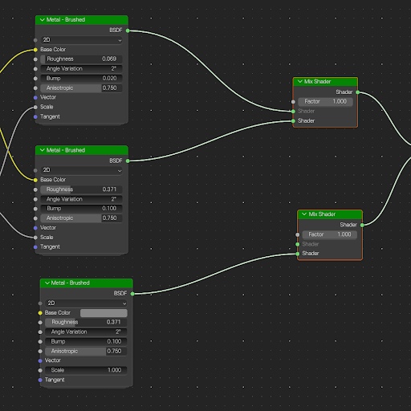
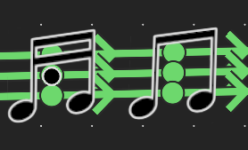
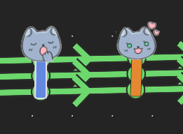
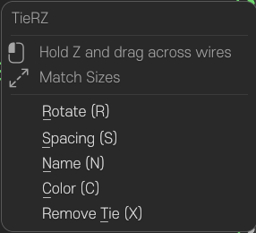

# TieRZ
TieRZ is a Blender add-on that organizes node links with movable cable ties (reroute bundles). It works on unmodified Blender and keeps all native node connections intact.

---

## 📸 Before & After

| Before (Tangled Spaghetti) | After (TieRZ Cable Ties) |
| :---: | :---: |
|  |  |

---

## 🎨 Tie Styles & Unique Designs
TieRZ allows customizing tie designs via the N-panel. In addition to clean standard ties, unique expressive styles are supported:
- **Classic Cable Tie**: Clean, minimal collar tags for standard workflow organization.
- **MACHOCAT**: Cute cat face collar design clamped over bundled wires.
- **MUSIC NOTE**: Musical note collar design adding rhythm to complex shader trees.

| MACHOCAT | MUSIC NOTE |
| :---: | :---: |
|  |  |

---

## Features
- Draw a stroke across wires to bundle them into a movable tie.
- Rotate, space, name, color, and remove ties from the right-click menu.
- Customizable tie appearance and styles (Classic, MACHOCAT, MUSIC NOTE via N-panel).
- Ties are designed to feel like native Blender controls, so they are easy to handle.
- Clean uninstall: removes control data so nothing is left behind.
- Multilingual interface: English, Korean, Simplified Chinese, and Japanese (more languages can be added via `i18n/*.json`).

---

## Installation
1. Download the latest release `.zip` from [Releases](https://github.com/narznarz/TieRZ/releases). *(Do not extract)*
2. In Blender: `Edit > Preferences > Add-ons` (or `Get Extensions` in 4.2+ / 5.x) `> Install...` and select the zip.
3. Enable **TieRZ** in the add-on list.
4. A `TieRZ` tab appears in the Node Editor sidebar (N panel).

---

## Usage
- **Create a tie**: hold the gesture key (default `Z`) and drag across wires.
- **Move a tie**: click a tie and drag it to reposition it; hold `Shift` while dragging to rotate it freely.
- **Remove ties with a stroke**: hold the gesture key (default `Z`) and draw a line across ties — every crossed tie highlights in red and is removed when you release (multiple ties at once). Reroute helpers are kept.
- **Right-click menu** (on a selected tie): (R) Rotate / (S) Spacing / (N) Name / (C) Color / (G) Move / (X) Remove.
- **N panel**: edit selected tie name, color, spacing, style (`MACHOCAT`, `MUSIC NOTE`, etc.), and appearance.
- **Match sizes**: `Alt+S` to unify selected tie sizes.
- **Move selected**: `G` to move selected nodes and ties together.
- **Remove**: `X` or `Del` (selected ties only; reroute helpers are kept).

  

### Keys
| Key | Action |
|---|---|
| `Z` (hold) + drag | Create a tie across wires, or draw across ties to remove them (red highlight) |
| Click + drag | Move a tie; hold `Shift` while dragging to rotate it |
| `R` | Rotate selected ties (smooth free rotation) |
| `S` | Adjust spacing |
| `N` | Name the selected tie |
| `C` | Change color |
| `X` / `Del` | Remove selected ties (reroute helpers are kept) |
| `Alt+S` | Match sizes |
| `G` | Move selected nodes and ties |

---

## Warnings
- **Uninstall cleanup**: before uninstalling, run `Clean Add-on Data` in the N panel to restore native links and remove metadata. Otherwise managed reroute nodes may remain.
- **Collapsed nodes**: drawing near collapsed (hidden) nodes may be ignored to avoid incorrect selections.
- **Read-only trees**: cleanup stops on read-only node trees.
- **Keymap conflicts**: the add-on registers shortcuts in the Node Editor keymap. If shortcuts do not work, check `Preferences > Keymap` for stale `tie.rz_*` entries.

---

## Background
The idea started as a prototype in a game engine, then moved to ComfyUI, and finally landed in Blender as NODE ZIP TIE. This add-on builds on that lineage. It is a free add-on; no grand claims intended.

---

## Credits & Special Thanks
The basic behavior was derived from NODE ZIP TIE, then almost entirely rewritten.

Deeply inspired by and grateful to wonderful contributors in the Blender ecosystem — including **aras-p** (ex-Unity), **ando** (ZOZO Inc.), and the **ACGGit** team — I am glad to contribute back to the 3D community with this add-on.

TieRZ is free and open-source, and **will always remain 100% free with no monetization or paywalls intended**.

---

## Copyright

  
  MACHOCAT character copyright &copy; <b>NARZ & 박냥냥</b>.

---

## License
SPDX:GPL-3.0-or-later (GNU General Public License v3.0)

---

## Version

